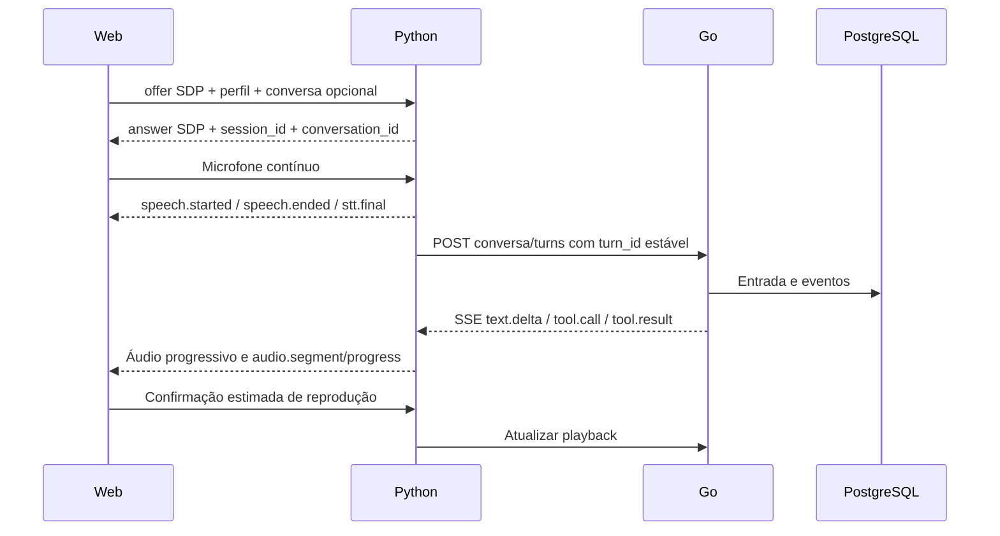
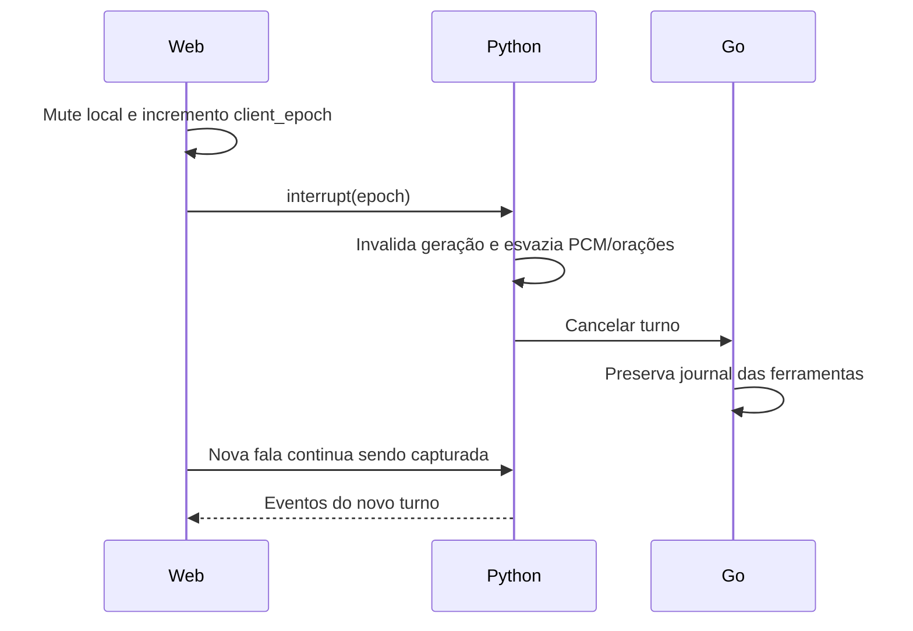

# Contratos do laboratório (v1)

## Autoridade e transporte

Go/PostgreSQL são autoridade de conversas, turnos, eventos e ferramentas. Python
mantém somente buffers e a sessão de mídia. WebRTC carrega áudio Opus bidirecional;
o data channel `jarvis` carrega controle/eventos. O frontend usa a mesma origem
HTTPS para `/api/*` e `/voice/offer`; não recebe chaves de provedores.



## Core HTTP

- `POST /api/v2/conversations` retorna `conversation_id`.
- `POST /api/v2/conversations/:id/turns`: `{turn_id,message,provider,model}`.
  IDs são 32 caracteres hexadecimais. `turn_id` deve permanecer igual em retries.
  Repetir o mesmo payload retorna `replayed=true`; um payload diferente sob o
  mesmo ID retorna conflito. Uma conversa só admite um turno gerando por vez.
- `GET /api/v2/turns/:turn/events?after=N`, também com `Last-Event-ID`: SSE
  persistido, ordenado por `seq`. Evento terminal: `turn.finished`.
- `POST /api/v2/turns/:turn/cancel`: cancela a geração ativa quando presente e
  registra entrega interrompida mesmo após a geração ter terminado. O resultado
  informa `provider_confirmed=false` e `cancel_state=local_discard`.
- `POST /api/v2/turns/:turn/playback`: `{segment,ms,finished?}`. Progresso é
  monotônico. `finished=true` marca `finished_estimated`, sem sobrescrever
  interrupção registrada.
- `GET /api/v2/conversations/:id`: os 100 turnos mais recentes, em ordem decrescente.
  Inclui `input`, `generated`, `status`, `delivery_status` e progresso de áudio.

Evento SSE:

```json
{"version":1,"seq":123,"turn_id":"32-hex","type":"text.delta","data":{"delta":"Olá"}}
```

Tipos principais: `turn.started`, `text.delta`, `tool.call`, `tool.result`,
`error`, `turn.finished`. Erros distinguem autenticação, modelo/cota e falhas de
transporte. Não há retry de cota nem troca automática para provedor pago.

`status=completed` significa geração finalizada, não prova que o áudio foi ouvido.
`delivery_status` é independente: `pending`, `interrupted`, `finished_estimated`.
Histórico interrompido é identificado no contexto enviado ao modelo.

## Sinalização e sessão

`POST /voice/offer` (proxy para Python `/offer`):

```json
{
  "type":"offer","sdp":"...",
  "profile":{"stt":"base","tts":"kokoro","voice":"pf_dora","turn":"silence"},
  "provider":"scripted","model":"",
  "conversation_id":"opcional-32-hex",
  "resume_session":"opcional-32-hex",
  "client_epoch":0
}
```

Retorna SDP answer, IDs e perfil. É permitida uma sessão de mídia por processo.
Para substituir uma sessão ainda ativa, é necessário apresentar seu
`resume_session`; caso contrário, retorna `session_in_use`. Trocar modelo espera
os workers anteriores terminarem, libera o modelo antigo e carrega só o novo.

Ao reconectar, envie a mesma conversa e o ID anterior da sessão. O transporte
novo ganha outro `session_id`; não reenvie automaticamente a entrada anterior.
O cliente recupera histórico via HTTP. A fila de áudio antiga não é retomada.

## Controle e eventos de voz

Browser → Python:

- String `ping` a cada segundo (keepalive SmallWebRTC).
- `{type:"interrupt",client_epoch:N}`.
- `{type:"text",text:"...",client_epoch:N}` para teste sem STT.
- `{type:"playback",turn_id,segment,ms,finished?}`.

Python → browser:

```json
{"version":1,"session_id":"32-hex","client_epoch":2,"type":"stt.final","data":{"turn_id":"32-hex","text":"Que horas são?"},"server_ms":12345.6}
```

Outros tipos: `session.ready`, `speech.started`, `speech.ended`,
`turn.interrupted`, eventos do Core, `tts.started`, `tts.first_pcm`,
`audio.segment`, `audio.progress`, `audio.generated`, `audio.finished`,
`playback.saved` e `error`.

Whisper por segmentos não oferece parciais nesta rodada: `session.ready` declara
`stt_partial=false`. Não simulamos uma transcrição parcial como se fosse final.
`audio.generated` significa síntese concluída; `audio.finished` indica fila de
saída drenada, ainda sem comprovação acústica do cliente.

`server_ms` usa relógio monotônico do servidor. Não o subtraia diretamente de
`performance.now()` no browser. `speech.ended` informa `endpoint_delay_ms` para
incluir o atraso estimado de fim de turno. O relatório do browser usa seu próprio
relógio e assinala as aproximações.

## Interrupção



O browser ignora eventos de sessão antiga, epochs anteriores e IDs de turnos
interrompidos. Python também usa um contador de geração no PCM e um sinal de
parada por turno. Interromper Kokoro/Whisper pode apenas descartar o resultado de
uma chamada CPU já em execução; Pocket recebe também seu sinal de parada.
Isso é distinto de cancelamento confirmado no provedor de IA.

O buffer anterior ao VAD preserva o início da nova fala. O frontend solicita AEC,
noise suppression e AGC e usa um detector local de energia para silenciar a saída
sem esperar a ida e volta ao servidor. A detecção final usa Silero; eco residual,
limiares e falsas interrupções precisam da avaliação com fone/alto-falante.

## Ferramentas e recuperação

O modelo sugere; o Go autoriza e executa pelo ToolRegistry. Na nova API apenas
horário e calculadora são permitidos. O journal usa `(turn_id,call_id)`; uma chamada
já concluída retorna o resultado persistido, e uma chamada incerta não é repetida.

Após reinício, turnos ativos tornam-se interrompidos, com deltas recuperados do
log. Execuções sem resultado ficam incertas. Ações externas futuras precisarão de
reconciliação e autorização próprias; este mecanismo não promete exatamente uma
execução para efeitos externos.
